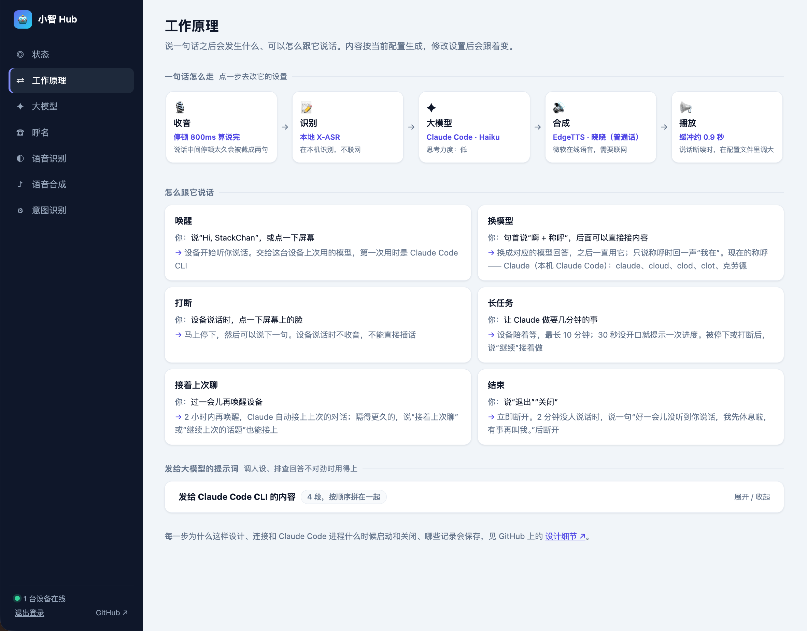

<p align="center">
  <picture>
    <source srcset="hub-docs/images/logo-dark.svg" media="(prefers-color-scheme: dark)">
    <source srcset="hub-docs/images/logo-light.svg" media="(prefers-color-scheme: light)">
    
  </picture>
</p>
<p align="center">Talk to Claude Code and other LLMs on your own computer through a Xiaozhi device.</p>
<p align="center">
  <a href="LICENSE"></a>
  
  
  <a href="https://github.com/justhalfbit/xiaozhi-hub-server/stargazers"></a>
  <a href="https://x.com/justhalfbit"></a>
</p>
<p align="center">
  <a href="README.md">简体中文</a> |
  <a href="README.en.md">English</a>
</p>
<p align="center">
  <a href="hub-docs/guide.md">User guide</a> · <a href="hub-docs/design.md">Design notes</a> (both in Chinese)
</p>

[](hub-docs/guide.md)

---

A **local hub server** for Xiaozhi devices (M5Stack StackChan, ESP32 boards, and more). The device listens and speaks; the server runs on your own computer and hands your speech to the local Claude Code, or to the LLM of your choice, to think and act.

> A community project compatible with the Xiaozhi protocol. Not an official Xiaozhi project.

> Want to know **why things work the way they do**—what happens from wake word to disconnect, when the device connection drops, when the Claude Code process starts and stops, what is written to disk, and why API models cannot resume a conversation? See the [design notes](hub-docs/design.md) (Chinese).

## Features

- **Voice access to your local Claude Code**: talk to the Claude Code you are already signed in to, and let it read files in its working directory and carry out tasks.
  - One long-running process per device, so replies come fast.
  - Interrupt the device while it speaks (on StackChan, tap the face on the screen or say the wake word), then keep talking.
  - Conversation resume: picks up automatically after a reconnect, and you can say "接着上次聊" ("continue where we left off") to resume an earlier conversation. → [design.md §6](hub-docs/design.md#6-会话接续只对-claude-code)
- **Other LLMs too**: Claude, OpenAI, Gemini, DeepSeek, Qwen, Doubao, Zhipu GLM, Kimi, and any OpenAI-compatible API.
- **Switch models by name**: after waking the device, say "嗨 + a name" (e.g. "Hey Claude", "Hey DeepSeek") to hand the conversation to that model. Each device remembers the model it used last, and each model only remembers its own conversations. Names can be recorded in the admin console by speaking to the device, so they match your pronunciation. → [design.md §5](hub-docs/design.md#5-呼名与多模型路由)
- **Local speech recognition**: the X-ASR Chinese-English model runs on your machine, no internet needed, and handles mixed sentences like "帮我跑一下 npm install". Speech synthesis uses EdgeTTS with a choice of voices.
- **Web admin console**:
  - Set up LLMs and API keys; choose the model, thinking level and permission level for Claude Code.
  - Give each model a name to call it by: add it by hand, or say it to the device a few times to record it.
  - Speech recognition: switch between local X-ASR and Doubao streaming ASR (just paste the API Key and test the connection); set how long a pause ends a sentence, hotwords (shared by both), and post-recognition corrections (e.g. turn "cloud code" into "Claude Code"); review recent transcripts and add misheard words to the hotwords or corrections in one click.
  - Pick and preview a TTS voice, configure intent recognition.
  - See environment checks and online devices, and send test expressions to a device.
  - A "How it works" page shows the full path of one sentence from the device to playback, and the prompt sent to the LLM.
- **One-command install and start**: a single command on macOS / Linux sets up Python, dependencies and the speech recognition model.

## Quick start

Requirements: macOS or Linux (the Windows script has not been tested), with the computer and the device on the same LAN. To use Claude Code, install it first and run `claude` once in a terminal to sign in.

```bash
git clone --depth 1 https://github.com/justhalfbit/xiaozhi-hub-server.git
cd xiaozhi-hub-server
bash scripts/install.sh   # install
bash scripts/start.sh     # start
```

After it starts, the terminal shows two addresses:

- **Admin console**: open `http://127.0.0.1:16688/admin` in a browser on this computer and set an admin password on first use.
- **OTA address**: `http://<your computer's LAN IP>:16688/xiaozhi/ota/`, entered when setting up the device's network.

## Connecting a device

When setting up the device's network, enter the OTA address above under "Advanced options" on the setup page. For StackChan step by step, FAQ and more settings, see the **[user guide](hub-docs/guide.md)** (Chinese).

## Security

- Use the server only on your LAN. Do not expose it to the internet.
- By default Claude Code can only access the working directory `~/xiaozhi-workspace`, with read-only tools. Once you allow writing files or running commands, voice commands can do the same, so be careful.

## Which directories are used

This project only runs `main/xiaozhi-server`. When the Xiaozhi firmware changes, the upstream server adapts to it, and this project merges upstream regularly to stay compatible with new firmware. To keep those merges free of conflicts, the rest of the upstream code is kept as is but not used, and you can ignore it:

| Directory / file | Notes |
| --- | --- |
| `main/xiaozhi-server` | **Used**: the server itself; all changes in this project live here |
| `scripts/` | **Used**: this project's install and start scripts |
| `hub-docs/`, `README.en.md` | **Used**: this project's documents (user guide, design notes, README images) and English README |
| `main/manager-api`, `main/manager-web`, `main/manager-mobile` | Not used: the upstream management console, replaced by this project's own web admin console |
| `main/digital-human` | Not used: the upstream digital human front end |
| `main/README.md`, `main/README_en.md`, `docs/` | Not used: upstream documentation, partly not applicable to this project |
| `Dockerfile-*`, `docker-setup.sh`, `.dockerignore` | Not used: upstream Docker deployment |
| `Makefile` | Not used: the upstream test entry point (including Java and front-end tests for the management console) |

## License

[MIT License](LICENSE). This project is based on [xinnan-tech/xiaozhi-esp32-server](https://github.com/xinnan-tech/xiaozhi-esp32-server) (MIT). Third-party credits are listed in the [user guide](hub-docs/guide.md#致谢与许可).
