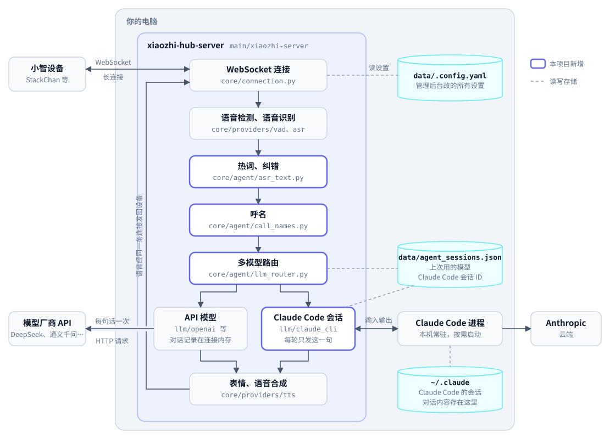
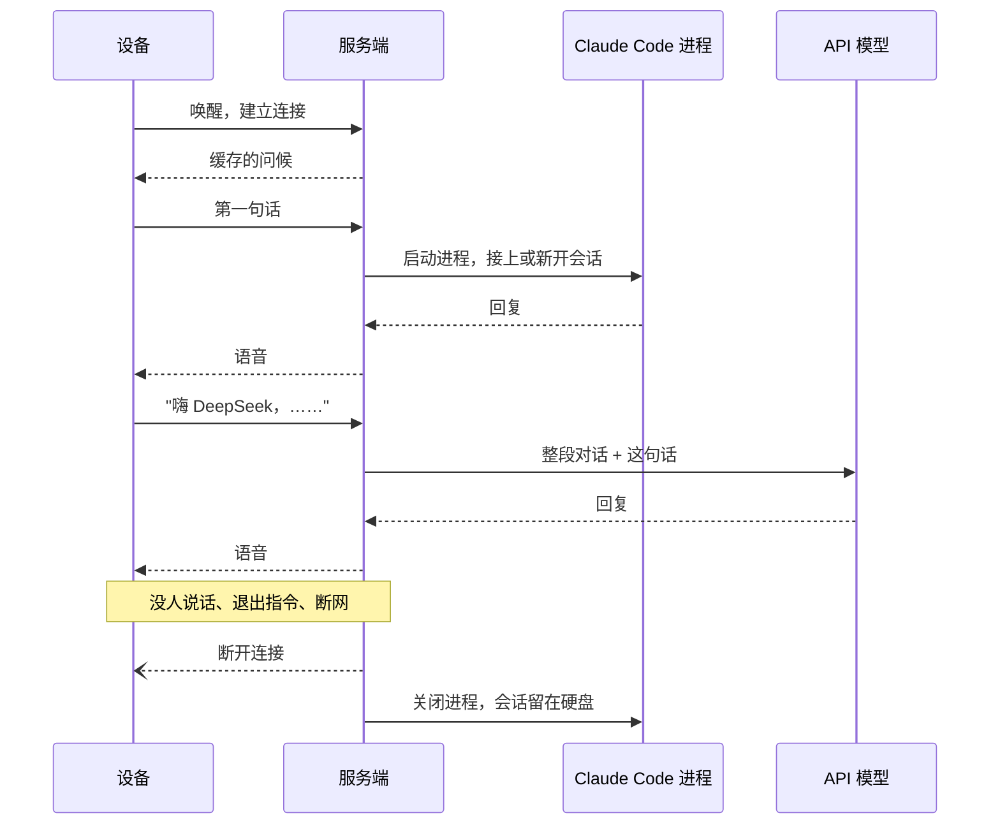

# 设计细节

[返回 README](../README.md) · [使用说明](guide.md)

这份文档记录本项目**为什么这样做**。README 讲它是什么，使用说明讲怎么用；这里讲一句话从设备到播放经过了哪些处理，每一段连接和进程什么时候开始、什么时候结束，什么会保存，以及那些想过又否掉的方案。

读者假定为想改这个项目的人，或者想搞清楚"它这次为什么没记住""为什么要等这么久"的人。文中路径都相对于 `main/xiaozhi-server/`，时长都是默认值。

---

## 目录

1. [三方和两段关系](#1-三方和两段关系)
2. [一次对话的完整经过](#2-一次对话的完整经过)
3. [一句话的处理流程](#3-一句话的处理流程)
4. [设备 ↔ 服务端：WebSocket 长连接](#4-设备--服务端websocket-长连接)
5. [服务端 ↔ 模型：没有长连接](#5-服务端--模型没有长连接)
6. [长任务和时间设计](#6-长任务和时间设计)
7. [呼名与多模型路由](#7-呼名与多模型路由)
8. [会话接续（只对 Claude Code）](#8-会话接续只对-claude-code)
9. [只说称呼时的回复](#9-只说称呼时的回复)
10. [语音识别：认准专有名词](#10-语音识别认准专有名词)
11. [什么保存、什么不保存](#11-什么保存什么不保存)
12. [被否掉的方案](#12-被否掉的方案)
13. [已知的未完成](#13-已知的未完成)

---

## 1. 三方和两段关系

<picture>
  <source srcset="images/architecture-dark.svg" media="(prefers-color-scheme: dark)">
  
</picture>

紫色边框是本项目新增的模块，圆柱是保存状态的地方，哪些重启后还在见 [§11](#11-什么保存什么不保存)。

两段关系的性质完全不同：

- **设备 ↔ 服务端**是一条真正的长连接。文档和后台里说的"**连接**""同一次连接"，指的都是这一条。
- **服务端 ↔ 模型**没有长连接。API 模型每句话发一次请求，回复完就结束；Claude Code 是本机的一个进程，它自己再去连 Anthropic。

"模型记不记得刚才聊的"取决于对话记录存在哪，而不是哪条连接还开着。这一点贯穿下面所有章节。

---

## 2. 一次对话的完整经过

下图是一个例子：先交给 Claude Code，再叫 DeepSeek 切过去。每一步的细节见下表。



| 步骤 | 谁在做 | 发生什么 |
| --- | --- | --- |
| 1. 唤醒 | 设备 → 服务端 | "Hi, StackChan"由设备在固件里识别，服务端听不到这句。设备连上服务端，再把唤醒词当作一句话发过来（StackChan 固定发"嘿，你好呀"）。服务端按 `wakeup_words` 认出是唤醒词，播放缓存的问候，不经过大模型。点屏幕唤醒没有问候，设备直接开始收音。 |
| 2. 恢复上次的模型 | 服务端 | 连接建立时，把这台设备切到它上次用的模型（第一次连上的设备用后台的默认模型）。这时不启动任何进程。 |
| 3. 叫模型（可选） | 服务端 | 句首是"嗨 + 称呼"：切到对应的模型并记住。只说称呼时回一声"我在"；带了内容就去掉称呼，把内容交给它。不说称呼：交给当前模型。 |
| 4. 第一句话 | 服务端 | 交给 Claude Code 时，这一刻才启动进程，同时决定接上旧会话还是新开（见 [§8](#8-会话接续只对-claude-code)）。交给 API 模型时，把这个模型在本次连接里的对话记录连同这句话一起发过去。 |
| 5. 对话中 | 服务端 | 后面每句话直接交给当前模型；随时可以叫别的称呼切换；设备说话时点屏幕或喊唤醒词打断。 |
| 6. 结束 | 服务端 / 设备 | 连接断开：没人说话、退出指令、设备休眠或断网等（见 [§4](#4-设备--服务端websocket-长连接)）。这次连接用过的每个模型都会收到通知，Claude Code 进程随之关闭。 |

后台"工作原理"页按当前配置展示其中用户能感知到的部分（每一步用的是什么、说什么会怎样）；实现细节都在这份文档里。

---

## 3. 一句话的处理流程

一句话从设备的麦克风到设备的喇叭，依次经过下面几步。大部分是上游原有的处理，本项目改动的地方单独标出。

| 步骤 | 做什么 | 本项目的改动 |
| --- | --- | --- |
| 收音 | 设备把麦克风声音编码成 Opus，每 60ms 一包，经 WebSocket 发给服务端；服务端解码成 16kHz 单声道 | — |
| 语音检测（VAD） | SileroVAD 判断每一包有没有人说话：概率 ≥ 0.5 算说话，≤ 0.3 算安静，安静超过 `min_silence_duration_ms` 就判定这句说完。不到 0.9 秒的声音直接忽略；唤醒后 2 秒内不收音，避免把唤醒词本身识别进去 | 停顿时长默认从 200ms 改为 800ms：200ms 时说话稍一停顿就被截成半句。后台可调，改了马上生效 |
| 语音识别 | 把这句话的音频转成文字，再按纠错表替换（见 [§10](#10-语音识别认准专有名词)）。去掉首尾标点后没有文字（例如只有噪音）就到此为止 | 默认识别换成本地 X-ASR；加了热词、识别后纠错和"最近识别"记录 |
| 呼名、指令 | 依次检查：句首是不是"嗨 + 称呼"（见 [§7](#7-呼名与多模型路由)）；整句是不是退出指令（"退出""关闭"，直接断开）；是不是唤醒词（播放缓存的问候）。命中的都不经过大模型。识别出的文字在这一步之后才发给设备显示（`stt` 消息），命中唤醒词时不发 | 呼名是新增的 |
| 意图识别 | 不用插件（`nointent`）：直接交给大模型。用插件（`function_call`）：把插件当作工具清单随请求发给大模型，由它决定要不要调用，一轮最多连续调用 5 次工具。Claude Code 有自己的工具，只能用 `nointent` | — |
| 大模型 | API 模型：系统提示词 + 本次连接的全部对话 + 这句话，流式返回。Claude Code：只发这句话，之前的对话在它自己的会话里（见 [§5](#5-服务端--模型没有长连接)） | 新增 `claude_cli`；对 Claude 官方接口自动关闭思考（首字等待 3～6 秒，还可能耗尽 `max_tokens`） |
| 表情 | 在回复的第一段文字里找第一个 emoji，对应成情绪名（例如 😂 → `funny`），找不到时用 🙂 `happy`；发一条 `llm` 消息给设备换脸。每轮只发一次 | 先说了填充语时，填充语会把表情锁成 😶；正式回复开头带了表情，就再补发一次 |
| 语音合成 | 边收回复边切句：第一句遇到逗号、顿号、冒号这类标点就切（让设备尽早开口），后面的句子遇到句号、问号、感叹号、分号、冒号才切。去掉 emoji、Markdown 符号和换行后逐句合成，编码成设备约定采样率的 Opus，每 60ms 一包 | — |
| 播放 | 每句开头先把设备的缓冲补到 N 包（`tts_audio_prebuffer_count`，安装时写进配置的是 15；配置里没有这一项时按上游的 5），之后按 60ms 一包匀速发送；每句开始前发一条 `sentence_start`，设备屏幕显示这句话；等设备把缓冲里的声音播完，再发 `tts stop`，设备回到收音 | 见下 |

### 播放为什么要"补缓冲"

上游只在每轮开头一口气发 5 包（0.3 秒），之后匀速发送。Wi-Fi 稍有抖动，设备缓冲就被吃空，说话一卡一卡的。改成两点：

- **默认 15 包（约 0.9 秒）**，并且可配置。15 是安装时写进 `data/.config.yaml` 的值；配置里没有这一项时，代码按上游的 5 包。调大更抗抖动，代价是点屏幕打断后，设备要把已经缓冲的部分播完才停；每轮说完后，也要多等一会儿才开始收音。
- **每句开头都补，而不只是每轮开头**。服务端估算设备什么时候播完已收到的声音（`play_end`），发送队列空了、下一句到来时，先把设备缓冲补到 N 包再匀速发。只补到 N，不在已有缓冲上再加 N，缓冲不会越积越多。不能只在"快播空"时才补：下一句在上一句还剩 0.2 秒时到达，整句就只剩 0.2 秒余量，很容易断续。

打断时，服务端清空还没发出的声音，立即发 `tts stop`；设备里已经缓冲的部分会播完才停。

### 设备每轮依次收到的消息

```
stt（识别出的文字） → tts start → llm（表情） → tts sentence_start（字幕） → Opus 语音包 … → tts stop
```

一轮里可能有多句，每句重复 `sentence_start` 和语音包。

---

## 4. 设备 ↔ 服务端：WebSocket 长连接

**开始**：唤醒设备（说唤醒词或点屏幕），设备连上服务端。每条连接有一个新的 `session_id`；设备用 `device-id` 标识自己，"上次用的模型"和 Claude Code 的会话都按 `device-id` 记。

**结束**，以下任一情况：

| 原因 | 配置项 | 行为 |
| --- | --- | --- |
| 没人说话（第一道） | `close_connection_no_voice_time`（默认 120 秒） | 说一句固定的告别语（`end_prompt.reply`），播完后断开 |
| 没有任何动静（第二道，兜底） | 同上，再加 60 秒（默认 180 秒） | 直接断开，没有告别语；日志里是"连接超时，准备关闭" |
| 说了退出指令 | `exit_commands`（默认"退出""关闭"） | 立即断开，没有回复 |
| 设备休眠、重启、断网 | — | 设备侧断开 |
| 服务端重启或停止 | — | 所有连接断开 |

中间可以说很多句、切换很多次模型，都在这一条连接里。

### 两道"没人说话就断开"

这两道都是上游原有的机制，看的是同一个"最后活动时间"。下面任一情况都会刷新它：

- 设备发来的麦克风声音里检测到有人说话；
- 设备发来文字（例如唤醒后发来的唤醒词）；
- 服务端正在给设备发语音；
- Claude 正在干活（见 [§6](#6-长任务和时间设计)）；
- 开启 `enable_websocket_ping` 时设备发来心跳（默认不开）。

| | 第一道 | 第二道 |
| --- | --- | --- |
| 在哪 | `core/handle/receiveAudioHandle.py` 的 `no_voice_close_connect` | `core/connection.py` 的 `_check_timeout` |
| 什么时候检查 | **每收到一包设备的麦克风声音时**，也就是设备正在收音 | 后台每 10 秒一次，不管设备在做什么 |
| 时长 | `close_connection_no_voice_time`，默认 120 秒 | 再加 60 秒，默认 180 秒 |
| 行为 | 说告别语，播完后断开（`end_prompt.enable: false` 时直接断开） | 直接断开，没有告别语 |

为什么要两道：第一道只在设备还在发声音时才会被检查到。设备没在收音（没发声音过来）、或者告别语没能正常播完时，第一道永远不会触发，就靠第二道把连接收掉。真机日志里两种都出现过：告别语之后断开，以及没有告别语的"连接超时，准备关闭"。

**告别语为什么是固定的一句**：上游让大模型按"请你以'时间过得真快'开头……"生成告别语。接 Claude Code 时，这句假的用户消息会被永久写进它的对话记录，下次接续时 Claude 还会看到。所以改成填了 `end_prompt.reply` 就直接说这句，不发给大模型。

**断开时**，`core/connection.py` 的关闭钩子调用 `llm_router.on_conn_close`：这条连接**用过的每个模型实例**都会收到 `on_conn_close`，而不只是当前那个。原因见 [§7](#切换后旧模型不马上释放)。

---

## 5. 服务端 ↔ 模型：没有长连接

### API 模型（OpenAI 兼容接口）

- 每句话发一次 HTTP 请求，流式接收回复，回复完这次请求就结束。底层的 HTTP 客户端可能复用 TCP 连接，但那不带任何会话状态。
- 每次都把这个模型的**整段对话记录**（系统提示 + 之前的问答 + 这句话）一起发过去。厂商那边不保存任何东西。
- 对话记录存在服务端内存里，挂在设备的那条连接上：同一次连接里切走再切回来还记得，**连接断开就清空**。

### Claude Code（本机 CLI）

- 服务端通过 claude-agent-sdk 启动一个本机 Claude Code 进程，经进程的输入输出通信，不走网络；Claude Code 自己再按轮请求 Anthropic。
- 每轮只发这一轮识别出的文字。之前的对话由 Claude Code 保存在本机的会话里，服务端只记会话 ID。
- 提示词在进程启动时一次性传入：Claude Code 自带的系统提示，后面追加我们的基础模板和语音规则（开头一个 emoji、简短口语、不用 Markdown、不要后台运行命令）。进程存活期间，模板里的日期、时间不会更新。
- 只读出主回复的文字（中间的过渡语也读）；思考、工具调用、工具结果不读，子代理的输出也不读。
- 工具权限有两道限制：每次调用工具前的 `PreToolUse` 钩子，拒绝工具列表之外的工具、拒绝访问工作目录之外的路径（包括 Glob 的 pattern 里藏着的绝对路径和 `..`）；需要人工审批时的 `can_use_tool`，语音场景没人能点"同意"，Auto 模式下，除了只读的工具（Read、Grep、Glob、WebSearch、WebFetch、TodoWrite），它自己没放行的操作一律拒绝。执行命令（Bash）的命令内容不做路径检查，所以 Auto 级别不受工作目录限制。
- 不加载用户的 hooks、插件、claude.ai 连接器等设置（`setting_sources=[]`、`strict_mcp_config`），行为可预期。

进程的生命周期：

| 事件 | 进程 |
| --- | --- |
| 唤醒、只说称呼 | 不启动 |
| 唤醒后第一句交给 Claude 的话 | 启动（约 0.5 秒），同时决定接续还是新开 |
| 一轮干活 | 最长 `turn_timeout_seconds`（默认 600 秒），超时就中断这一轮；进程保留，但中断 5 秒后这一轮还没停下，就强制关闭进程 |
| 空闲 `idle_timeout_seconds`（默认 300 秒） | 关闭；会话还在，下一句话重新启动并按 [§8](#8-会话接续只对-claude-code) 判断接续 |
| 切到别的模型 | 不马上关，等空闲超时再关 |
| 设备断开、服务停止 | 关闭 |
| 打断 | 发中断让本轮停下，进程保留；中断 5 秒后本轮仍没结束，就强制关闭进程 |

因为没人说话 120 秒（最晚 180 秒）就会断开设备连接，进程通常是随设备断开一起关的，300 秒的空闲超时主要在"切到别的模型后"才派上用场。

**线程模型**：上游的大模型接口是同步生成器，在每个连接的线程池里迭代；claude-agent-sdk 是 asyncio 接口。`claude_cli` 自带一个后台线程跑事件循环，所有 SDK 调用都在里面执行，两边用队列传事件。管理后台热加载大模型时，旧实例不会马上关掉：已连接的设备继续用它，等最后一个连接关闭、手上的任务结束后，后台线程才退出。

### Grok Bot（云端）

- Grok Bot 没有公开 API。每个账号在云端有一台 Linux 电脑，Bot 跑在里面，电脑内 1340 端口有一个 HTTP + SSE 的网关；桌面 App 和手机 App 本身就是这个网关的客户端。服务端做的事是"扮演一个 App"：用 Cursor 账号登录（PKCE，浏览器里批准，token 有效期 60 天、到期前自动续期），向 api2.cursor.sh 的 EnsureSandBox 要到云端电脑的网关地址和令牌（休眠时先唤醒），再 `POST {网关}/api/sendPrompt` 发消息、`GET {网关}/events` 收推送。接口随 App 版本变化，2026-10-21 对 App 0.72.0 实测可用。
- 消息进的是该 Bot 的主对话（App 里能看到），所以不需要接续逻辑，"会话 ID"就是 Bot 的 id。每个勾选的 Bot 是一个 `type: grok_bot` 的 LLM 条目（`GrokBot_<名字>`），由后台生成；同一个账号的所有 Bot 共用一条事件流。
- 一轮的经过：先记下对话尾部已有的条目 → `sendPrompt`（带 `clientNonce`，结果不明确时查 `promptAcceptanceStatus`，不盲目重发）→ 从事件流收 Bot 开始处理、我们的消息回显、回复条目、Bot 空闲 → 空闲 1.5 秒无新动静算本轮结束。多条回复每条到了就念；回复里的 Markdown 记号会去掉。
- **兜底**：事件流偶尔"假活"（连着、每 15 秒一个 ping、约 57 秒服务端断一次，但不推事件）。发送后 10 秒没看到回显就重连事件流并补拉对话尾部；等待期间每 12 秒轮询一次（`listAgents` 看状态 + 拉尾部）；推送和轮询按条目 id 去重，谁先到用谁。
- 打断只停止播报，不向云端发停止，Bot 会把任务做完；Bot 需要审批或回答问题时念一句"Grok Bot 在等你去 App 里处理"并结束本轮。
- **做完再汇报**：被打断（含等超时）时，会话留一个后台任务用自己的订阅继续盯这个 Bot，最多 2 小时；Bot 空闲（或等用户）时把收到的回复拼成"孙悟空做完了：……"放进待汇报箱（`core/agent/reports.py`，按设备存，只在内存，24 小时过期）。念的时机：设备在线且空闲（没在说话、没在听、不在一轮里）就马上念，走和呼名回复"我在"同一条服务端主动出声的路；设备不在线就等下次连上、问候播完后念；用户说"嗨 孙悟空"或给它派新活时先念。新活派出时后台任务停掉，它已收到的话作为新一轮的开头先念。
- **热身**：设备叫到这个 Bot（或重连沿用它）时就在后台 EnsureSandBox 并订阅事件流，第一句话到了只等热身完成，不算卡住。
- 每句话后面附提示语（默认"回复会被语音朗读：请口语化、尽量简短，不要用列表、表格和代码"，`voice_hint` 可改可关），回显按 clientNonce 或完整文本匹配。
- 连接管理、空闲关闭、填充语（默认"交给 Grok Bot 了"）、进度提示、超时都复用 `claude_cli` 的 provider（`grok_bot` 继承它，只换掉会话的创建方式），所有 `grok_bot` 实例共用一个后台事件循环。
- 合规：走的是非官方接口，xAI 的条款禁止逆向工程、Cursor 的条款禁止抓取数据；这里没有反编译 App，只用自己的账号操作自己的 Bot，频率和人工相当。风险主要是 App 升级后接口变化，而不是封号；社区至今没有封号记录。

### 三者对比

| | 什么时候开始 | 什么时候结束 | 对话记录存在哪 | 能跨连接接续 |
| --- | --- | --- | --- | --- |
| API 模型 | 每句话一次请求 | 这句话回复完 | 服务端内存，跟着设备连接 | ❌ |
| Claude Code | 唤醒后第一句交给 Claude 的话 | 空闲超时、设备断开、服务停止 | 本机硬盘（Claude Code 自己的会话） | ✅ |
| Grok Bot | 唤醒后第一句交给它的话（订阅事件流） | 空闲超时、设备断开后取消订阅；事件流再空闲 60 秒关闭 | Bot 的云端电脑（App 里同一份） | ✅（天然如此） |

### Grok Bot 的生命周期与多模型协作

上面讲的是机制，这一节按"用的时候会碰到什么"的顺序串一遍，也回答几个最常被问到的问题。

**网关和 Grok Bot 之间到底是什么**

- 每个 Grok Bot 账号在云端有一台 Linux 电脑，Bot 在里面跑，电脑内 1340 端口有一个 HTTP + SSE 网关。桌面 App、手机 App 本身就是这个网关的客户端。服务端做的事就是"扮演一个 App"：同样的登录、同样的网关调用。所以设备发的话必然出现在 App 里——两边读写的是同一份对话记录。
- 和云端的通信分两种。**短请求**：发消息（`sendPrompt`）、列 Bot（`listAgents`）、读对话记录（`getAgentTranscriptTail`），发完就结束。**长连接**（`GET /events`，SSE）：只负责收，云端有动静就推过来——对话里新增或更新了一条（包括我们发的话的回显和 Bot 的回复）、Bot 的状态变了（开始处理、空闲、等用户审批）。它不能"推到设备"，只能推到服务端，念不念由服务端决定。
- 长连接**不是**服务启动就建、服务停止才断。第一次有设备跟某个 Bot 说话时才打开；所有 Bot 的会话都收起来之后再过 1 分钟就关。云端约每 57 秒主动断一次，服务端自动重连，用户感觉不到。整个账号只有一条，所有 Bot 共用：每条推送上都带着是哪个 Bot 的，服务端像分信一样，按信封上的名字丢进对应的"信箱"（会话的队列），没人登记的 Bot 的信直接扔掉。
- **叫醒 ≠ 维持长连接**。叫醒是向 Cursor 后台发一个短请求（`EnsureSandBox`，带 wake）让那台电脑运行起来，拿回网关地址和令牌；之后才能连长连接。电脑何时休眠由云端自己决定，服务端不会为了保持连接去反复叫醒它。它换了机器（网关地址变了）时，连接错误会触发重新要地址。

**只跟一个 Bot 通信时的一轮**

| 时刻 | 发生什么 |
| --- | --- |
| 唤醒设备 | 设备连上，沿用上次用的模型。上次是某个 Bot 就立刻**热身**：后台叫醒它的云端电脑、连上长连接 |
| 说"嘿 孙悟空"（只有称呼） | 把这台设备的"当前模型"指针拨到孙悟空，回一声"我在"（有待汇报的话跟在后面念），同样触发热身。不发任何消息给 Bot |
| 说任务 | 先读一次对话尾部记下"已有哪些条目"，再 `sendPrompt`。热身没做完就等它，这段不算卡住 |
| 等待 | 设备陪着等，4 秒没回音先说"交给 Grok Bot 了"，30 秒说"还在处理"，之后 90、210、330 秒各报一次已用时间；Bot 每回一条念一条 |
| 结束（正常） | Bot 空闲 1.5 秒无新动静（忙过却一条回复都没来则多等 5 秒），设备回到听你说话 |
| 结束（超时） | 等满 10 分钟（`turn_timeout_seconds`）说"做得太久，我先不等了，做完后我再告诉你"，转入下面的"做完再汇报" |
| 之后 | 会话（这台设备对这个 Bot 的"本子"）留 5 分钟没人用才收；所有本子收完 1 分钟后长连接关；设备 2 分钟没人说话断开时本子随之收起。下次唤醒直接说话还是给它 |

**打断之后，各部分怎么变**

- 打断的只是设备这一轮：设备不再听这个本子、回到听你说话。长连接不变，Bot 在云端继续做，云端对此一无所知。
- 服务端留一个**后台盯着**的任务（`AfterWatch`）：它有自己的信箱，继续收这个 Bot 的回复，最多 2 小时。Bot 空闲后把收到的话拼成"孙悟空做完了：……"放进这台设备的**待汇报箱**（只在内存，服务重启即丢，24 小时过期）。
- 念的时机有三个：设备在线且空闲（没在说话、没在听你说、不在一轮里）就马上念；设备在休息就下次连上、问候播完后念；你说"嘿 孙悟空"或给它派新活时先念。派新活时后台任务停掉，它已收到、还没汇报的话作为新一轮的开头先念。
- 设备在 Bot 干活时**断开**（没声音超时、断网）和打断是同一种处理：转后台盯着，下次连上念。
- 打断后不切 Bot、再说一句：照常发。但它回上一件事的话如果这时才到，会被当成新回复念出来（对话只有一份，分不清是回哪句的）。
- 打断后切到另一个 Bot：另一个 Bot 的回复照常念；第一个 Bot 做完后进待汇报箱，设备空闲时念。

**不同模型之间怎么协作**

每台设备只有一个"当前模型"指针，你喊称呼就把指针拨过去，之后每句话发给指针指着的那个。模型之间互不知道对方存在，没有谁等谁，各自记各自的对话。几类模型在服务端里长什么样、被打断后怎么样，差别如下：

| | 服务端里有什么 | 对外连接 | 打断后 |
| --- | --- | --- | --- |
| Grok Bot（每个 Bot 一个条目） | 一个 provider 实例；所有 Bot 共用一条后台线程（事件循环）；每台设备对每个 Bot 一个会话对象 | 整个账号一条长连接 + 短请求 | 只停播报，云端继续做，做完再汇报 |
| Claude Code | 一个 provider 实例，自己一条后台线程；每台设备一个本机进程 | 不走网络 | 真的停下，5 秒不停就关进程 |
| Codex CLI | 一个 provider 实例，自己一条后台线程；每轮一个 `codex exec` 子进程 | 不走网络，Codex 自己再请求 OpenAI | 普通打断转到后台，做完再念；整句「停止 / 取消」才杀进程。等确认时，点屏幕是同意 |
| API 模型 | 一个 provider 实例 | 每句话一次 HTTP 请求 | 不再读这次回复，什么都不剩 |

所以"很多个 AI 在外面干活、干完回来汇报"发生在 Grok Bot 和本机 Codex 上。Claude Code 和 API 模型被打断就停了。切换时的复用规则：切走再切回同一个 Bot，5 分钟内本子还在就直接用（省掉 1 到 20 秒的准备时间）；超过 5 分钟重新开一个，对话内容不丢，因为它存在云端。Claude Code 对应的是进程留 5 分钟、会话 2 小时内可接续。Codex 不留长驻进程，线程号记在 `data/agent_sessions.json` 的 `codex_cli` 里，下一轮用 `codex exec resume <线程号>` 接上，线程号只来自上一轮的 `thread.started`。

**常见疑问**

- *设备不收音是服务端做的吗？* 不是。一句话说完设备就进入等待状态，直到这轮播报结束才重新开始听，这是固件的状态机。服务端只做两件事：隔一会儿说一句进度、刷新连接的活动时间不让它因"没人说话"断开。中途想说话只能按键或喊唤醒词打断。
- *在电脑 App 里手动发消息，Bot 回了，设备会念吗？* 不会。设备只在"自己发了话、正在等"的那一轮里念东西，这段时间之外推来的事件直接丢掉；每一轮开始前记下的"已有条目"也都算历史。例外：设备正在等某个 Bot 时你在 App 里也给它发了一句，它回 App 那句的回复也会被念出来。
- *两台设备同时用一个 Bot？* 两边都会念到对方的回复，一方的回合还要等 Bot 把另一方的活也做完。对话只有一份，条目上没有发起者信息，分不开；一个 Bot 一次只从一头跟它说话。
- *Bot 自己的定时任务跑完会念吗？* 不会，只盯设备派出去的活。要做的话需要常开长连接（等于一直把云端电脑叫醒）或不叫醒的低频查询，暂未做。

---

## 6. 长任务和时间设计

### 设备陪着等

让 Claude 做一个要几分钟的任务时，设备一直处在"服务端在说话"的状态，不收音，服务端也可能很久不出声。原来这会出三个问题，现在分别这样处理：

| 问题 | 处理 |
| --- | --- |
| 单轮上限只有 120 秒，到点就中断 | 默认改为 600 秒（`turn_timeout_seconds`，后台可调） |
| 3 分钟没有任何动静，兜底断开连接（见 [§4](#两道没人说话就断开)），进程随之关闭，做到一半的任务也停了 | Claude 干活期间不断刷新这条连接的活动时间 |
| 执行一条很慢的命令时，Claude Code 很久没有事件，被"连续 30 秒没动静就是卡住"误杀 | 记录正在执行、还没返回结果的工具；有工具在跑时不算卡住，只受单轮上限约束 |

另外，没开口超过 `progress_interval_seconds`（默认 30 秒）就提示一次进度，让人知道还在做。第一次说 `progress_reply`（默认"还在处理，请稍等"），之后报已用时间（"还在处理，已经 3 分钟了"）。间隔逐次翻倍、最多拉长到 4 倍。原来每 30 秒说同一句，10 分钟要说 20 遍，太吵也听不出进展。

进度提示不会插在半句话中间。Claude 说完一句没有句末标点的过渡语（"我先看一下文件""我跑一下这个命令："）就去调用工具时，会先补一个句号：TTS 遇到句末标点才念，不补的话这句要等工具跑完才念出来，几分钟里一直静音。超时、出错的提示也一样先把半句收住，不会粘成"我先看一下文件这件事做得太久"。

做完之前设备一直在"说话"状态，这段时间不能插话，只能打断。原因是设备的收音方式：StackChan 用的是自动模式（listen 消息里 `"mode":"auto"`），说话时不收音；边说边听需要实时模式和回声消除，由固件决定，服务端改不了。所以使用说明里提示"想说话先点屏幕打断"。

### 超时或打断后说"继续"

超时和打断都只中断**这一轮**，进程和会话都在：Claude 记得已经做了哪些步骤、拿到了哪些结果，说"继续"它就接着做。被中断的那条命令本身会被终止，接着做时要重跑这一步，已经改好的文件不受影响。实测：三步各 25 秒的任务在第三步被中断，说"继续"后 Claude 只重跑了第三步。

点屏幕打断时，这一轮在服务端立刻结束，不再保活、不再说话。不能等 Claude 自己结束：它卡住不理中断时，会一直等到单轮上限，期间连接也不会因为没人说话断开。

中断 5 秒后这一轮仍没停下（Claude Code 卡死），进程会被强制关闭，卡住的那一轮也一并取消（只关进程不一定能让它退出，它会一直占着锁，让下一句话排队）。这时说"继续"会启动新进程，按 [§8](#8-会话接续只对-claude-code) 的规则在 2 小时内自动接回原会话。为此，会话 ID 在 **Claude 开始处理这一轮时**就记下，不等这一轮正常结束；否则新会话的第一轮卡死后，记录里还是上一个会话，就接不回来了。一开始就出错（例如没登录）时不记，免得覆盖之前能接续的会话。

### 时间设计一览

所有和"等多久"有关的时间放在一起看。第一行是服务的全局配置，"中断无效"写死在代码里，其余都能在后台"大模型 → Claude Code → 高级设置"里改。

| 时间 | 默认 | 管什么 | 到点后 |
| --- | --- | --- | --- |
| 没人说话断开（`close_connection_no_voice_time`） | 120 秒；兜底再加 60 秒 | 设备连接 | 第一道说告别语后断开，第二道直接断开（见 [§4](#两道没人说话就断开)）。**Claude 忙的时候不计时** |
| 填充语（`filler_delay_seconds`） | 2 秒 | Claude 迟迟不开口 | 先说一句"好的，我看一下" |
| 进度提示（`progress_interval_seconds`） | 30 秒起，逐次翻倍到 2 分钟 | 干活时设备多久没开口 | 说"还在处理，请稍等"，之后报已用时间 |
| 无响应（`stall_timeout_seconds`） | 30 秒 | Claude Code 有没有卡住 | 停下这一轮，提示"稍后跟我说继续"。**执行命令时不算** |
| 单轮上限（`turn_timeout_seconds`） | 600 秒 | 一整轮最多干多久 | 停下这一轮（正在跑的命令一起终止），提示"跟我说继续就行"。连接不断 |
| 中断无效（代码里的 `abandon_grace`） | 5 秒 | 中断后 Claude 还停不下来 | 强制关闭进程，下一句话重新启动并接回会话 |
| 进程空闲（`idle_timeout_seconds`） | 300 秒 | Claude Code 进程没活干 | 关闭进程。通常在这之前设备已经因为 2 分钟没人说话断开，进程随连接一起关了 |
| 自动接续（`resume_window_minutes`） | 120 分钟 | 下次唤醒接不接上次的会话 | 超过就新开，说"接着上次聊"仍能接上（见 [§8](#8-会话接续只对-claude-code)） |

**"无响应"指什么**：Claude Code 正常干活时会断断续续发回消息（思考、说话、开始执行命令、命令返回结果）。连续 30 秒一条都没有，多半是和 Anthropic 的网络卡住了，就停下这一轮，免得用户干等到单轮上限。但 Claude 执行一条命令时，命令跑完之前 Claude Code 确实什么都不发，所以服务端记着"有命令在跑、还没返回结果"，这段时间不按 30 秒判断。

**进度提示不是固定次数**：规则是"设备多久没开口"，不是固定时刻。设备每开口一次，计时就从头开始（填充语、Claude 自己说的话、进度提示都算）；从开口算起，第 1 次提示等 30 秒，第 2 次 60 秒，之后每次 120 秒。所以：

- Claude 全程不说话（比如一直在跑一条长命令）：第 2 秒的填充语也算开口，所以在约第 32、92、212、332、452、572 秒各提示一次，10 分钟正好 6 次（关掉填充语时是第 30、90、210……秒）；
- Claude 中途自己说话（"第一步做完了"）：从它说完重新计时，提示会少；
- 任务提前做完：后面的提示自然没有了。

**单条命令也有上限，而且不归我们管**：Claude Code 自己的 Bash 工具对单条命令有超时，默认 2 分钟；Claude 可以给某条命令设得更长，但最多 10 分钟。语音规则里要求 Claude"需要等的命令在前台运行，把超时设够"，实测它会主动设成 2 到 5 分钟。所以单条命令最多 10 分钟，这是 Claude Code 的限制；一整轮最多 `turn_timeout_seconds`，一轮里可以有好几条命令，单轮上限调大只对这种情况有用。

**后台设置的几点说明**：

- 单位是秒，例如单轮想放宽到 20 分钟就填 1200；
- 单轮超时和无响应超时填 0 表示不限制，但不建议：万一卡在某条命令上，设备会一直处在"说话"状态，只能点屏幕打断。空闲关闭填 0 是每轮结束就关进程，自动接续填 0 是只在说接续指令时才接上；
- 保存后服务端马上换上新设置，已经连着的设备仍按旧值，重新连接后生效；
- 升级时注意：早期版本安装时生成的 `data/.config.yaml` 里写的是 `turn_timeout_seconds: 120`，配置文件优先，升级代码后仍是 2 分钟，需要在后台改成 600。

**一个 5 分钟任务的完整时间线**：

| 时间 | 发生什么 |
| --- | --- |
| 0:00 | 说完话，Claude 开始干活，连接的"没人说话"计时暂停 |
| 0:02 | "好的，我看一下" |
| 0:32、1:32、3:32 | 进度提示（假设 Claude 中途没说话；从 0:02 的填充语算起） |
| 5:00 | 播报结果，Claude 不忙了，开始计 2 分钟 |
| 7:00 | 没人说话：说告别语，断开连接，Claude 进程随之关闭 |
| 下次唤醒 | 还是上次用的模型，2 小时内自动接上原来的对话 |

---

## 7. 呼名与多模型路由

代码：`core/agent/call_names.py`（匹配称呼、录入）、`core/agent/llm_router.py`（切换模型）。呼名在 `startToChat` 里、意图识别之前处理。

### 称呼怎么认

- 只认**句首**的"招呼语 + 称呼"。招呼语是 嗨、嘿、hi、hey、hai、high、hiigh、hei、he、h：语音识别常把"嘿"识别成 He、Heい（多语言模型会冒出日文假名）、H，这些都是真机日志里出现过的。单个 h 后面必须是停顿，否则 Hello、H5 这类词会被误认。
- 称呼后面不能紧跟英文字母：否则"嗨 Claude Code 怎么安装"会被当成在叫 Claude，把"Code 怎么安装"交出去。
- 连说两遍称呼（实测出现过 "Hi, cloud. Hi, cloud."）一并去掉。
- 每个模型配一组别名。语音识别几乎认不准英文称呼（Claude 全部被识别成 cloud），所以别名要按用户的实际发音来定：后台"呼名"页的"用设备录入"会把设备接下来说的 3 句话只记录识别结果、不交给模型，提取出称呼供勾选。

### 称呼对应什么

称呼对应 LLM 配置里的一个**条目**（如 `ClaudeCLI`、`DeepSeekLLM`），只能选已经配置好的：Claude Code 条目，或在"大模型"页填好接口地址、模型名和 Key 的厂商。叫到一个后来没配置好的模型时，回"XX 还没配置好"，不切换。

### 按连接切换

原项目里所有连接共用一个 LLM 实例（`ws_server._llm`）。路由不改这个共享实例，只换**这条连接**的 `conn.llm` 和 `conn.dialogue`：

- 模型实例按条目名缓存，所有连接共用。后台默认模型直接用 `ws_server._llm`；其他模型第一次被叫到时才创建。
- 后台保存了某个模型的配置后，旧实例退役（`shutdown`），下次叫到时重建；在线连接继续用旧实例，重连后才用新的。和原项目"热加载后设备重连才生效"的规则一致。
- 第一次创建实例放在线程池里做：claude_cli 初始化时会运行 `claude --version`，不能阻塞事件循环。

### 各聊各的

每个模型在一条连接里有自己的一份对话记录。第一次切过去时新建，只带系统提示和工具调用示例，不带别的模型的聊天内容。Claude Code 只取每轮最后一句，会话本来就由它自己按设备保存，不受影响。

选"各聊各的"而不是"切换时带上下文"：不同模型的回复风格和能力不同，把 A 的对话塞给 B，B 会接着 A 的口吻说话，也会把 A 用工具做的事当成自己做的。

### 切换后旧模型不马上释放

切走时不关 Claude Code 进程，等空闲超时再关，方便马上切回来时不用重新启动。代价是：同一条连接可能同时挂着好几个模型实例，所以连接关闭时要通知**每一个用过的**，否则切走的那个 Claude Code 进程会一直留到空闲超时，设备已经断开也一样。

### 上次用的模型

按 `device-id` 存在 `data/agent_sessions.json` 的 `last_model` 里，断线重连、服务重启后仍有效。连接建立时恢复；那个模型已不存在或没配置好时，退回后台默认模型。

---

## 8. 会话接续（只对 Claude Code）

代码：`core/agent/voice_commands.py`（`match_resume`）、`core/agent/session_store.py`（`choose_resume`）、`core/providers/llm/claude_cli/claude_cli.py`（`_ensure_agent`）。

**只在启动进程时判断一次**，也就是唤醒后第一句交给 Claude 的话，或者进程空闲关闭后的下一句。进程已经在运行时，"接着上次聊"就是一句普通的话。

| 第一句话 | 有会话记录 | 结果 |
| --- | --- | --- |
| 接续指令（"接着上次聊""继续上次的话题""继续刚才的话题""接着刚才聊"） | 有 | 接回上次的会话，不管隔了多久；整句只有指令时回"好的，我们接着上次聊" |
| 接续指令 | 没有 | 新开，回"没有找到之前的对话，我们重新开始吧" |
| 普通的话 | 有，且距上次不超过 `resume_window_minutes`（默认 120 分钟） | 自动接上，然后回答这句 |
| 普通的话 | 超过窗口，或没有 | 新开会话 |

细节：

- 接续指令后面带着内容（"接着上次聊那个 bug"）时，接上后把整句交给 Claude，不吞掉后半句。
- 前面带否定词（"别接着上次聊"）不算。
- 5 个字以上的关键字，在整句话基本就是这条指令时允许错 1 个字（实测"接着上次聊"被识别成"接着上次量"）。长句里不容错：命中接续指令的话不会发给 Claude，误判会把真问题吞掉。
- 记录里的会话在 Claude Code 那边已经不存在时，改为新开；新会话也启动失败（比如没登录、断网）时不删旧记录，下次还能接续。
- 处理顺序是先去掉称呼、再判断接续，所以"嗨 Claude，接着上次聊"一句话也行。

**API 模型没有接续**：对话记录在服务端内存里，连接断开就没了；"接着上次聊"会当普通的话交给模型。

### 为什么只说称呼时不启动进程

启动进程时要决定接续还是新开，而这取决于下一句是不是"接着上次聊"。如果在只说称呼时就启动，就只能先按时间窗口决定，等下一句说"接着上次聊"时再切换会话，逻辑复杂得多，换来的只是省掉约 0.5 秒的启动时间。

---

## 9. 只说称呼时的回复

只说"嗨 + 称呼"时，服务端切换模型后直接回一句固定的话（默认"我在"），不经过大模型。要快，有两处讲究：

- **一次合成**：TTS 遇到句中的逗号会切成几段，逐段合成、播放。原来的"我在，请说"被切成两段，段间要等两三秒。现在回复（包括后台自定义的）会先去掉句中标点。
- **缓存音频**：EdgeTTS 走网络，合成"我在"两个字也要约 2 秒。音频按 TTS 类型、音色、采样率和文字缓存在内存里：第一次照常合成，同时在后台缓存，之后直接发出（和上游唤醒词回复的播放方式一样）。实测从说完称呼到出声，由约 2 秒降到几乎为 0，整段由 6 秒多降到约 2 秒。

缓存只在内存里：只缓存实际用到的那一种组合，换音色或改回复会按新的组合重新合成一次；服务重启后清空，重启后的第一次又要合成。

---

## 10. 语音识别：认准专有名词

跟 Claude Code 说话免不了中英夹杂（"帮我跑一下 npm install""看看 GitHub 上的 issue"），专有名词认错一个，整句意思就变了。为此做了四件事。

### 默认用 X-ASR

上游默认用 FunASR，需要 torch，安装包很大。本项目默认改用 sherpa-onnx 版的 X-ASR 中英混合模型（int8，约 175MB），只依赖 onnxruntime。实测 35 句中英混合口语：错字率 3.9%（SenseVoice 是 8.1%），每句约 90ms，内存约 0.5GB。

### 热词

热词让识别在几个读音相近的候选里，偏向你给的写法。

- **所有支持热词的识别共用一份**，存在配置顶层的 `asr_hotwords`。切换识别时不用重新维护。
- **X-ASR**（transducer）：解码时改用 `modified_beam_search`，给热词加分。它只会在候选里挑，不会凭空编出没说过的词。模型包只带 `bpe.model` 时，首次加载会用 sentencepiece 导出热词需要的 `bpe.vocab`。
- **豆包**：热词直接放进请求（`corpus.context`）。双向流式接口最多约 100 个 token，官方没说怎么算，这里往多了估，超出的从后面截掉，后台会提示哪些没带上。
- **呼名里的模型名字自动并入热词**，并且放在最前面，截断时优先保住。只用模型的正确名字（Claude、DeepSeek），不用别名：别名本来就是"认错的样子"（如 cloud），当热词反而会让识别更偏向错的写法。

### 识别后纠错

有些词发音几乎一样，换模型、加热词都救不回来（实测 "Claude Code" 总被识别成 "cloud code" 或"克拉德扣的"），只能在识别出文字后按替换表改正。

- 替换表是"正确写法 → 认错的写法"，存在 `asr_corrections`，在识别结果进入呼名、意图识别之前替换。
- 匹配忽略大小写，中英文之间有没有空格都算；以英文开头或结尾的写法要求整词匹配，"cloud code" 不会改到 "cloud coder" 里。长的写法先替换，避免 "cloud" 抢在 "cloud code" 前面。
- 认错的写法至少 2 个字，太短容易误改普通的话。
- 改了马上生效，不用设备重连：每句话都按连接当前的配置去查。

### 最近识别

服务端在内存里记最近 30 句识别结果（原文和纠错后的文字），后台"语音识别"页可以看到，认错的词一键加进热词或纠错表。不落盘，服务重启后清空。

### 豆包流式识别的两处修正

- **断句时长跟着"说完停顿"走**：豆包由识别服务自己判断一句话说完，上游写死 200ms，说话中间稍一停顿就被截成半句。现在用 VAD 的 `min_silence_duration_ms`（不小于 200ms），后台改了马上生效。
- **连不上时不再反复重连**：Key 不对、网络断了时，上游每个有声音的音频帧都重连一次，说一句话要连几十次。现在失败后隔 3 秒再试，并让设备说一句"语音识别连不上，请在管理后台检查豆包的密钥和网络"（每分钟最多一次），免得设备一直不出声、用户不知道发生了什么。这句提示不写进对话记录。
- 新版火山引擎控制台只给一个 API Key，填了它就不用 APP ID 和 Access Token；日志里的 token 只留前 4 位。

---

## 11. 什么保存、什么不保存

| 状态 | 在哪 | 断开重连后 | 服务重启后 |
| --- | --- | --- | --- |
| 每台设备上次用的模型 | `data/agent_sessions.json` → `last_model` | ✅ | ✅ |
| 每台设备的 Claude Code 会话 ID 和最后活跃时间（Claude 开始处理时就记，每轮结束再更新） | `data/agent_sessions.json` → `claude_cli` | ✅ | ✅ |
| 每台设备的 Codex 线程号（只保存 `thread.started` 里的 id） | `data/agent_sessions.json` → `codex_cli` | ✅ | ✅ |
| Claude Code 的对话内容 | Claude Code 自己的本机会话 | ✅ | ✅ |
| 称呼、回复、开关 | `data/.config.yaml` → `call_names` | ✅ | ✅ |
| 热词、纠错表 | `data/.config.yaml` → `asr_hotwords`、`asr_corrections` | ✅ | ✅ |
| API 模型的对话记录 | 服务端内存，跟着连接 | ❌ | ❌ |
| 这条连接当前的模型、用过的实例 | 服务端内存，跟着连接 | 从"上次用的模型"恢复 | 同左 |
| Claude Code 进程 | 本机进程 | ❌ 已关闭，下一句重新启动 | ❌ |
| "我在"的音频缓存 | 服务端内存 | ✅ | ❌ 第一次重新合成 |
| 最近识别的句子 | 服务端内存 | ✅ | ❌ |
| 录入称呼的状态和结果 | 服务端内存 | — | ❌ |
| 管理后台的登录状态 | 服务端内存 | — | ❌ 需要重新登录 |

---

## 12. 被否掉的方案

- **只说称呼时就启动 Claude Code 进程**：能省约 0.5 秒，但会让"接着上次聊"的判断变成启动后再切换会话。见 [§8](#为什么只说称呼时不启动进程)。
- **切换模型时立即关闭旧进程**：省一点内存，但切回来要重新启动。来回切换是常见用法，所以改为等空闲超时。
- **切换时把对话带过去**：见 [§7 各聊各的](#各聊各的)。
- **API 模型跨连接接续**：要把每台设备、每个模型的对话记录存盘，还要决定存多长、怎么截断、何时过期。现阶段收益不大，先只在一次连接内保留。
- **切换时替换共享的 `ws_server._llm`**：会把所有设备一起切走。改为按连接切换。
- **每条连接各自创建模型实例**：claude_cli 每个实例自带一个后台事件循环线程，按连接创建会让线程随连接数增长。改为按条目名共享实例，实例内部按连接分开状态。
- **预先合成所有音色的回复**：绝大多数音色永远用不到。只缓存实际用到的那一种。
- **只说称呼时不出声、直接回到收音**：最快，但用户不确定设备有没有听到。保留一声短回复。
- **把呼名的别名也当热词**：别名是"认错的样子"，加进热词会让识别更偏向错的写法。只用模型的正确名字。
- **用意图识别小模型判断"接着上次聊"**：多一次模型调用、多一份延迟，关键字匹配加 1 个错字的容错已经够用。

---

## 13. 已知的未完成

- **长任务只能陪着等**（Claude Code）：设备断开（休眠、断网）时，正在做的任务会跟着停。"放到后台做完、下次唤醒再汇报"对 Claude 还没做。Codex 在按键或唤醒词打断后会转到后台，做完用语音汇报；汇报只在内存里，服务重启就丢。设备断开时，Codex 这一轮同样转到后台。
- **Codex 的执行沙箱到 `workspace-write` 为止**。部署、付款、发信如果需要更大权限，会在沙箱里失败，服务端不会自动升到 `danger-full-access`，也不会加 `--full-auto`。
- **Codex 确认依赖固件已有的 abort**。点屏幕或按键时，官方小智固件发送 `{"type":"abort"}`，不需要改 StackChan 固件。唤醒打断如果带的 `reason` 里有 `wake`，不会被当成确认。自定义固件若在唤醒时发送不带原因的 abort，而此时又正在等确认，这一下会被当成同意。
- **儿童模式没有工具**。它只调用配置的 OpenAI 兼容聊天接口。隔离开启时（默认），呼名不能切到 Codex 或其他模型，重连也不会恢复成上一次的别的模型。安全过滤是关键词加可选的审核接口，拦不住所有绕过说法，家长仍应看 `data/kid_mode/chat.jsonl`。
- **Grok Bot 走的是非官方接口**：App 升级后 `sendPrompt` 的返回、事件字段都可能变，变了要回归；现在没带桌面 App 的 `x-cursor-checksum` 头，服务端以后开始校验的话会先被拒。
- **同一个 Grok Bot 同时只能一台设备用**：对话在云端只有一份，两台设备同时派活会互相念对方的回复（回复条目上没有发起者信息，分不开）。
- **后台取消勾选 Bot 或退出登录，对正连着的设备不立刻生效**：已创建的会话和后台盯着的任务用缓存的网关令牌继续到结束，设备重连后才按新配置走。
- **Grok Bot 的定时任务不会汇报**：只盯设备派出去的活；Bot 自己的 Routine 跑完的结果要去 App 里看。做完再汇报的内容只在内存里，服务重启就丢。
- **称呼整个没被识别出来**（比如只识别出 "Hey."）时，服务端无从判断你在叫谁，只能交给当前模型。可以用"用设备录入"把你的发音加进称呼。
- **录入称呼时可能截掉开头**：识别结果没带"嗨"、称呼本身又以 hai、he、hi 开头时（比如只识别出 "Haiku"），提取出来会少掉开头（"ku"）。页面上能看到提取结果，不勾选即可。
- **添加模型时，预填的称呼已被别的模型占用就会跳过**，需要手动加别的写法。
- **Windows 还没有开机自启和一键更新**：需要每次开机手动运行 `start.ps1`，更新时手动 `git pull` 再运行 `install.ps1`。
